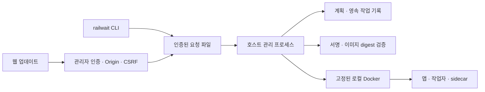

# CLI 설치와 웹 업데이트 개선 설계

작성일: 2026-11-13. 2026-11-17 macOS Lima 로컬 패키지 신규 설치 검증 완료.
공개 릴리스·Docker Desktop·Windows 실설치·재부팅 검증은 남아 있다.

설치는 CLI에서 끝내고 이후 업데이트는 웹의 버튼 또는 CLI로 실행한다. 일반 사용자는 Git·Python·Node.js를
설치하지 않고 검증된 실행 파일과 Docker 이미지를 받는다. Windows·macOS·Linux는 처음부터 같은 구현
범위에 포함한다. 실제 사용할 수 있는 명령과 제한은 [CLI 안내](../apps/cli/README.md)를 따른다.

## 지원 범위

| 항목 | Windows | macOS | Linux |
| --- | --- | --- | --- |
| CLI | amd64·arm64 `.exe` | amd64·arm64 | amd64·arm64 |
| 앱 실행 | Docker Desktop의 Linux 컨테이너 | Docker Desktop 또는 파일 공유가 구성된 로컬 Docker VM | 로컬 Docker의 Linux 컨테이너 |
| 관리 서비스 | 현재 사용자 Task Scheduler | 현재 사용자 LaunchAgent | 사용자 systemd |
| 자동 시작 | 사용자 로그인 시 | GUI 로그인 시 | user session; 부팅·로그아웃 유지는 별도 lingering 설정 필요 |
| 권한 | 현재 사용자 DACL | 소유자 권한·상속 ACL 제거 | 소유자 권한 |

Docker Compose 2.24 이상을 검사한다. Windows·macOS 대화형 설치는 없는 Docker Desktop·Tailscale의
공식 패키지를 내려받아 배포자 서명을 검사하고 OS 설치 창을 연다. WSL 설치·업데이트도 같은 흐름에서
진행하되 관리자 권한·약관·VPN·로그인 승인은 사용자가 처리한다. 재부팅 필요 상태에서는 멈추고 재실행을
안내한다. Linux·비대화형 실행은 필수 도구를 먼저 준비하며 파일 공유·권한 부족도 해결 전까지 진행하지
않는다. 방화벽 개방이나 user lingering 설정은 변경하지 않는다.
NAS, 원격 Docker context와 Windows 컨테이너 모드는 지원 범위에 포함하지 않는다.

세 OS의 코드를 함께 제공하는 것과 실제 설치 검증은 구분한다. macOS 네이티브·Linux ARM 실행 테스트와
6대상 교차 컴파일은 수행했지만 Windows 네이티브 CI 결과·Docker Desktop 새 설치·미검증 OS의 서비스 등록·재부팅
복구 검증은 공개 전 완료 조건으로 남긴다. Windows와 macOS 기능을 다음 릴리스로 미루는 순서는 아니다.

2026-11-17에는 macOS ARM과 기존 Lima Docker에서 새 CLI로 서명한 로컬 패키지를 설치했다.
별도 경로·18080 포트·새 Compose 프로젝트에서 관리자 생성, LaunchAgent 실행, 장기 서비스 12개
healthy, migration·log-init 종료 0, 웹·healthz·readyz 응답 200을 확인했다. 기존 서비스는 유지했다.
이 결과는 macOS의 실제 로컬 설치·서비스 등록 검증이며, Docker Desktop 최초 설치나 재부팅 후
복구·Windows 네이티브 설치까지 검증한 것은 아니다.

같은 날 Windows의 기존 Docker Desktop에서 별도 전달한 v2 스냅샷을 전수 SHA·Git fsck로 확인하고
Linux amd64 앱 4종을 빌드했다. 네트워크 없는 실행 확인과 Python 3.12 패키지 계약 27건을 통과했고,
새 테스트 키로 서명한 19서비스·11고유 이미지 패키지를 Windows CLI로 검증했다. 이미지 archive는
2,115,412,992바이트이며 패키지의 CPU·소스 지문·이미지 ID를 ARM 패키지와 분리해 보존했다.
새 테스트 private 키는 Windows에서만 보호·사용한 뒤 삭제했다. 지정 검증 VM은 관리자 실행이 취소되어
시작하지 못했으므로 실제 최초 설치·로그인·HTTPS 승인·재부팅 검증은 미완료다.

## 사용자 흐름

공식 Release에서 OS·CPU에 맞는 `railwait` 실행 파일을 받은 뒤 다음 명령으로 시작한다.

```console
railwait install
railwait status
railwait doctor
```

Windows PowerShell에서는 내려받은 경로에서 `./railwait.exe install`로 실행한다. 설치 안내에는 실행 파일의
SHA-256 확인 방법을 함께 제공한다. 개발 바이너리에는 신뢰 공개키가 없으므로 공식 설치를 허용하지 않는다.
서명된 정식 바이너리·이미지·번들의 공개가 먼저 필요하다.

공개 전 로컬 설치는 `railwait install --package <폴더> --trust-key <공개키 파일>`로 제공한다.
직접 신뢰한 별도 키로 서명된 패키지만 허용하며 공식 검증키·다운로드 정책을 완화하지 않는다.
패키지는 Compose·설정 예제·infra 파일과 태그 없는 Docker 이미지 묶음을 포함한다. 지원 CPU는
패키지에 명시한 Docker Linux CPU로 제한하고, 기존 설치와 다른 경로·포트·프로젝트로 설치한다.
설치 기록은 로컬 출처를 유지하며 정식 웹 업데이트 적용은 차단한다. 패키지·키의 영속 보존으로
설치 재개를 지원하고, 자세한 생성·사용 절차는 CLI 및 릴리스 도구 안내를 따른다.

설치 마법사는 실행 환경 → 설치 계획 → 앱·계정 → 자동 시작 → 접속 확인으로 이어진다. PATH 밖의 OS별
설치 경로까지 찾고 기존 Lima·Colima 등의 정상 로컬 Docker를 재사용한다. 없는 도구만 자동 설치하며
중지되었거나 일부만 설치된 앱은 덮어쓰지 않는다. Docker 전역 context를 바꾸지 않고 각 Railwait 설치의
프로젝트·볼륨·포트를 분리한다. 기존 설치에서는 계정·API 키를 유지하고 필요한 접속 설정을 이어간다.
TTY에는 실제 작업명·경과 시간과 다운로드 바이트 기준 진행률을 표시하며 `--plain`·NO_COLOR·비TTY에서는
커서 제어를 사용하지 않는다.

중단·재부팅 안내에는 실제 실행 파일과 원래 설치 옵션을 유지한 재개 명령을 표시한다. 설치 폴더,
패키지·신뢰키, 접속 방식·포트·Docker context, 입력 파일과 `--plain`·`--yes`·`--open`·`--custom`을 보존한다.
파일 경로는 절대경로로 바꾸고 POSIX 셸과 Windows PowerShell에 맞게 인자를 인용한다. 앱 상태 기록 전에는
상태 조회를 안내하지 않는다. stdin 입력은 다시 전달해야 하며 비밀번호·키 원문은 재개 명령에 넣지 않는다.
Windows 준비 중 재부팅이 필요하면 HKCU `Run`에 다음 로그인의 재개를 등록한다. 보호된 옵션 파일에는
비밀값을 담지 않고 동일 실행 파일·패키지·입력 경로를 보존한다. 원본 파일 이동·삭제, stdin 입력, Windows
자동 실행 명령의 길이 제한 초과는 자동 재개할 수 없는 조건으로 구분한다. 자신의 등록은 실행 시 한 번
소비하며 취소·실패 시 이번 자원만 정리한다. 기존 예약·다른 파일을 보존하고 공통 커널 잠금으로 직렬화한다.

필수 도구 다운로드는 고정된 공식 HTTPS 호스트와 크기 제한을 적용하고 사용자 전용 임시 폴더를 사용한다.
macOS는 Docker DMG의 앱·설치 프로그램 서명과 Tailscale PKG의 배포자·Gatekeeper를 확인한다. Windows는
Authenticode·게시자·실행 직전 파일 해시를 확인하고 Docker를 사용자별 WSL 2 방식으로 설치한다. WSL은
2.1.5 이상과 실행 상태를 검사한 뒤 필요하면 배포판 없는 설치 또는 업데이트를 시작한다. Windows ARM의
Docker Desktop은 공식 Early Access이며, 상세 요구사항은 [Docker Windows 설치](https://docs.docker.com/desktop/setup/install/windows-install/),
[Docker macOS 설치](https://docs.docker.com/desktop/setup/install/mac-install/),
[Tailscale 설치](https://tailscale.com/download)를 따른다.

다운로드·검증 취소 시 임시 파일을 지운다. 네이티브 설치가 시작된 뒤에는 Ctrl+C만으로 설치 프로세스를
종료하지 않고 OS 창의 완료·취소까지 기다려 사용 중인 설치 파일을 보존한다. macOS DMG 연결 해제에
실패하면 임시 경로를 남기고 알린다. `InstallResult`의 설치 완료·사용자 조치·재부팅 필요 상태를 구분하며,
설치 프로세스 종료만으로 Docker 준비나 Tailscale 로그인을 완료 처리하지 않는다.

새 대화형 간편 설치는 Tailscale HTTPS를 기본으로 하며 `--access local`은 로컬 전용으로 선택한다.
기존 설치와 비대화형 기본값은 보존한다. Tailscale 연결은 로그인 상태·기존 Serve·Funnel을 검사하고 비어 있는 HTTPS 포트를
사용한다. `NeedsLogin`에서만 옵션 없는 `tailscale up`으로 로그인을 시작하며 기존 프로필을 전환하는
`tailscale login`은 사용하지 않는다. 검증한 공식 `/a/…` 로그인 주소를 브라우저로 한 번 열고 출력 원문을
숨긴다. `NoState`·초기 daemon 오류·기기 승인·일시 오프라인은 최대 5분 상태를 다시 확인하고, 이미 연결된
노드나 오프라인 상태에서는 자동 로그인 명령을 실행하지 않는다. 허용 출처와 보안 쿠키를 암호화 백업·drain·재시작
경계로 변경한다. Tailscale CLI에는 설정
CAS가 없으므로 적용 전후 대조로 외부 변경을 탐지하며 전역 설정을 복원하거나 덮어쓰지 않는다.
새 경로만 확인 가능한 경우에 한해 정리하고, 앱 적용·gate 상태가 불명확하면 복구를 위해 보존한다.
서로 다른 설치의 같은 호스트 쿠키 격리는 포트만으로 제공되지 않는다.
첫 HTTPS 사용 승인은 공식 `login.tailscale.com/f/serve` 주소만 검증해 대화형 브라우저로 인계한다.
사용자가 HTTPS를 승인하면 최대 5분의 대기 안에서 같은 계획으로 재확인한다. 공개 Funnel은 선택하지
않도록 안내하고 CLI가 Funnel·ACL 설정을 변경하지 않는다. 일회용 주소는 오류·상태 기록에 남기지 않는다.

설치 CLI는 접속 포트·설치 위치에 기본값을 쓰고 관리자 계정을 입력받으며 내부 보안키 6종과 브라우저 알림용 VAPID
키를 자동 생성한다. 간편 설치는 접속 방식·계획 확인·키 입력·TAGO 입력 질문을 생략하고 완료 후 앱을 연다.
`--custom`은 접속 방식·키·TAGO 입력을 직접 선택한다. 보호된 JSON으로도 보유한 키를 지정할 수 있다.
`--yes`에서는 별도 입력한 키가 없으면 자동 생성 기본값을 사용한다. TAGO와 관리자
비밀번호는 숨김 입력하며 명령행 인자로 받지 않는다. TAGO는 생략할 수 있지만 시간표 검색은 키 설정 뒤
사용할 수 있다. TAGO 발급은 외부 서비스에서 사용자가 직접 진행하며 CLI가 대신 발급하지 않는다.
철도사 계정은 설치 뒤 기존 웹 설정에서 연결한다. 자동 예약 gate는 기본 비활성이다.

설치 JSON의 `app_secrets`는 `POSTGRES_PASSWORD`, `SECRET_ENCRYPTION_KEY`, `AUTH_SESSION_SECRET`,
`KORAIL_BROWSER_ADAPTER_TOKEN`, `SRT_PROVIDER_ADAPTER_TOKEN`, `KORAIL_PROVIDER_COOLDOWN_REDIS_PASSWORD`
여섯 이름만 허용한다. 직접 지정한 값은 영문·숫자·`-`·`_` 32~1024자이며 생략한 항목은 자동 생성한다.
`webpush`는 `public_key`, `private_key`, `subject`를 받는다. 키는 raw P-256을 패딩 없는 base64url로
표현하고 32바이트 비밀키와 대응하는 65바이트 공개점의 일치를 검사한다. 한쪽만 입력하면 거절한다.
subject는 포트·경로 없는 HTTPS 호스트 주소 또는 mailto 주소다. 현재 발송 라이브러리와 호환되도록
자동값은 계획한 HTTPS 주소의 호스트명만 사용하고, 로컬 전용이면 호스팅 도메인 `https://github.com`을
사용한다. 기본 도메인은 운영자별 연락처가 아니므로 구체적인 연락처는 수동으로 지정할 수 있다.
기존 PEM·DER 키도 표현을 보존하며 기존 내부 키와 VAPID 키의 자동 회전·다른 키로의 교체는 허용하지 않는다.
브라우저와 OS의 알림 허용은 사용자가 웹 설정에서 직접 진행한다.

이후 웹에서 **설정 → 로그·진행 상태 → 앱 업데이트**를 연다. 현재·최신 안정 버전을 확인하고 접속 중단
안내에 동의한 뒤 업데이트 버튼을 누른다. 데모·기존 Git 설치·관리 프로세스 미연결·호환되지 않는 릴리스는
적용할 수 없으며, 조회 실패를 최신 상태로 표시하지 않는다.

CLI에서도 같은 작업을 실행한다.

```console
railwait update --dry-run
railwait update --target <확인한 버전> --plan <계획 ID>
railwait status --job <작업 ID> --json
railwait configure
railwait configure --plan <계획 ID>
```

`configure` 명령은 TAGO 키를 지원한다. 비밀값은 보호된 후보 파일에 저장하고 공개 계획에는 넣지 않는다.
HTTPS 접속 설정은 `install --path <기존 경로> --access tailscale` 마법사에서 별도의 `configure_access`
계획으로 처리한다. 이 계획은 허용 출처 두 항목과 보안 쿠키만 바꿀 수 있다. 기존 설치의 누락된 VAPID
설정은 같은 마법사의 `configure_push` 계획으로 보완한다. 변경 허용 범위는 공개키·비밀키·subject 세 항목이며
기존 유효한 키는 보존하고 한쪽만 남거나 손상된 키는 자동 교체하지 않는다. subject 변경도 같은 계획을
사용한다. 암호화 백업·drain·서비스 재생성·health 확인을 거치며 외부 알림 채널과 브라우저 권한은 기존
웹 설정에서 처리한다.

## 최초 설치

1. OS·CPU, Docker Linux daemon·Compose 버전, 로컬 socket/pipe, 포트·파일시스템 여유 공간을 검사한다.
   Docker 대상 주소를 설치 기록에 고정하며 shell의 `DOCKER_HOST`·Compose 환경변수로 대상을 바꾸지 않는다.
2. 새 설치 ID와 프로젝트명을 만들고 커널 잠금으로 동시 설치를 막는다. 기존 파일이나 프로젝트 자원은
   덮어쓰지 않는다. 기본 저장소는 Windows `%LOCALAPPDATA%/Railwait`, macOS 사용자 Application Support,
   Linux XDG data home이다. `--path`로 Docker VM에 공유된 위치를 선택할 수 있다.
3. 공식 안정 Release의 manifest 서명, 버전·아키텍처·최소 CLI 버전, 번들 SHA-256·크기를 검사한다.
   tar 경로 탈출·symlink·중복 파일·크기 초과를 거절하고 배포 파일 지문을 설치 기록에 보존한다.
4. `.env`의 암호화키·세션키·DB 비밀번호·내부 token 여섯 개는 직접 입력값을 검증하거나 각각 별도 난수로
   생성한다. VAPID P-256 키 쌍과 subject도 준비한다. 기본 접속은 loopback 전용이며 공개 관리자 가입은
   비활성화한다. 재실행 때 기존 키를 재생성하지 않는다.
5. 이미지 다운로드 후 API 원샷 명령으로 컨테이너에서 읽은 관리 gate generation이 호스트와 같은지 확인한다.
   Docker Desktop/VM 파일 공유가 안 되면 DB 기동·migration·관리자 생성 전에 중단한다.
6. DB·Redis 준비 → migration → stdin 관리자 bootstrap → 전체 서비스 기동 → digest·health 확인 순서로 진행한다.
   관리자 생성 commit 뒤 CLI가 종료됐다면 계정 존재를 먼저 확인하고 재생성하지 않는다. 생성 전이면 다시
   입력받는다. migration 도중 중단돼 결과가 불명확하면 자동 재실행하지 않는다.
7. 설치가 완료되면 CLI를 보호된 `.railwait/bin`에 보존하고 OS 사용자 관리 서비스를 등록·시작한다.
   앱 설치 성공과 관리 서비스 등록 성공을 구분한다. 등록 실패는 `railwait manager install`로 재개한다.

최초 설치 자체는 CLI 프로세스가 수행하며 중단 후 같은 명령으로 재개한다. 설치 전체를 호스트 관리 서비스가
자동으로 이어가는 기능은 아직 없다. 호스트 파일시스템은 최소 4 GiB를 검사하지만 Docker VM 내부 용량과
이미지 압축 해제 전체 크기를 충분하다고 보장하지 않는다.

## 관리 경계



웹/API에는 Docker socket이나 shell 실행 권한을 주지 않는다. API는 검증된 `target_release_id`, `plan_id`,
`idempotency_key`만 받는다. 요청의 임의 URL·명령문·Compose 경로를 실행하지 않는다. 인증 token은 설치별
호스트 전용 부모 디렉터리 안에 보존하고 API에만 읽기 mount한다. 요청·상태 파일에는 비밀값을 노출하지 않는다.

세 OS 모두 파일 IPC를 사용한다. API는 `requests`에만 쓸 수 있고 `auth`·`status`·`control`·`gate`는 읽기 전용이다.
작업자·sidecar는 `control`·`gate`만 읽는다. 호스트 부모는 현재 사용자 전용 권한으로 제한한다. 관리 서비스는
토큰·DTO를 다시 검증하며 순차 실행, 멱등성, heartbeat와 중단 기록을 관리한다. 재시작 시 실행 중이던 작업을
성공으로 추정하거나 무조건 재실행하지 않고 `recovery_required`로 남긴다.

현재 API는 다음 계약을 제공한다.

| 경로 | 역할 |
| --- | --- |
| `GET /api/v1/system/update` | 관리 상태·현재/최신 버전·적용 가능한 계획과 사유 |
| `POST /api/v1/system/update` | 관리자·CSRF 검증 후 `202`와 작업 ID 반환 |
| `GET /api/v1/system/update/jobs/{id}` | 비밀값 없는 작업 단계·결과 조회 |

## 업데이트와 설정 변경

일반 업데이트는 `main` 커밋이 아닌 서명된 stable Release만 사용한다. 계획은 설치 ID·현재 버전·대상 버전·
번들·설정·설치 기록 지문과 15분 만료 시각에 묶인다. 실행 직전에 다시 검사하며 확인 중 새 릴리스가 나와도
대상을 바꾸지 않는다. 최초 자동 적용 범위는 다음 조건을 모두 충족해야 한다.

- 현재 설치와 대상의 DB revision·설정 schema가 같고 실제 DB revision도 일치한다.
- manifest가 현재 출발 버전을 `compatible_from`으로 명시한다.
- PostgreSQL·Redis digest와 서비스 집합이 같다.
- 현재 서비스의 실행 digest·health, 배포 파일 지문과 관리 gate가 정상이다.

상태 흐름은 `checking → downloading → draining → backing_up → applying → verifying → resuming`이다.
설정 변경은 같은 관리 작업에서 다운로드 대신 보호된 설정 후보를 준비한다.

로컬 패키지 설치는 공식 resolver 대신 운영자가 호스트 CLI에 직접 지정한 서명 로컬 패키지와 공개키로만
업데이트한다. 계획은 서명 manifest 전체 지문과 공개키 지문에 묶이고, 적용은 관리 서비스를 거치지 않고 CLI
프로세스가 같은 설치 잠금으로 실행한다. 관리 서비스 요청에는 패키지 경로가 없으므로 이 계획을 적용할 수 없다.
로컬 manifest에는 `compatible_from`이 없어 출발 버전 조건은 운영자의 명시적 선택과 위의 나머지 동일성 조건으로
대신한다. 기존 관리 서비스 실행 파일이 새 보존 패키지를 계속 읽도록 manifest 형식은 바꾸지 않았다. 상태 흐름은
`downloading` 대신 `loading_package`에서 패키지를 설치 경로로 복사·재검증하고 이미지를 불러온다. 보존 패키지는
새 서비스 확인 직전의 `replacing_package`에서 교체하고 설치 기록 전에 실패하면 이전 패키지로 되돌린다. 교체 전에
이전 패키지의 임시 위치를 작업 기록(`.railwait/updates/<작업 ID>.json`)에 남기고, `railwait status --job`은 관리
서비스 기록이 없으면 이 기록을 읽는다. 설치 상태 검증이 실패할 때 남은 이전 패키지가 있으면 해당 작업 ID를 안내한다.
CLI 프로세스에서 실행하므로 터미널 연결 끊김(SIGHUP)과 닫힌 출력 pipe는 무시해 작업을 끝까지 진행하고, SIGTERM과
Ctrl-C는 context 취소로 바꿔 같은 실패 경로와 기록을 거친다. 설치 기록 파일 교체 뒤 디렉터리 동기화만 실패하면
디스크의 기록을 다시 읽어 그 버전에 맞는 보존 패키지를 유지한다.
Windows는 폴더 안 파일이 다른 프로세스에 열려 있으면 이름 변경을 거부하므로 교체·되돌리기·복원·정리는 거부 오류에 한해
최대 30초 다시 시도하고, 교체가 끝내 거부되면 이전 패키지 폴더가 실제로 생긴 경우에만 작업 기록에 남긴다.
저장소 커밋을 반영하는 `scripts/update-local-install.sh`는 이 경로를 감싸는 운영 도구다. 작업 전용 태그 이미지,
일회성 서명키, 같은 커밋의 CLI로 계획과 적용을 실행할 뿐 업데이트 계약은 바꾸지 않는다.

다운로드·이미지 pull·복구키 준비를 먼저 끝내고, 변경 전 설치 기록을 보존한다. gate를 닫으면 새 HTTP·작업자·
sidecar 작업과 provider 예열을 막는다. 공유 Linux `flock`은 실제 외부 작업이 끝날 때까지 유지하며,
async waiter가 취소돼도 살아 있는 SRT 스레드·분리된 브라우저 작업은 drain 완료로 보지 않는다. SSE도 종료한다.
종료 대기 제한을 넘기면 `deferred`로 남기고 앱을 교체하지 않는다.

확정 drain 뒤 DB와 기존 `.env`를 age로 암호화한다. 설정은 복호화 후 원본 비교, DB는 복호화 스트림 전체를
`pg_restore`로 읽어 검증한다. 실제 DB 복원 검증은 별도 테스트로 수행한다. 백업 검증이 실패하면 서비스를
교체하지 않는다. PostgreSQL·Redis를 유지한 채 앱·원샷 서비스를 새 digest로 재생성하고 health를 검사한다.
새 상태를 기록한 뒤 gate를 다시 연다. 기존 UNKNOWN·cooldown·예약·계정 자료나 선택 gate를 초기화하지 않는다.

웹 연결 종료는 작업 취소가 아니다. 웹은 작업 ID를 세션 저장소에 기억하고 다시 조회하며, 401은 재로그인을
안내한다. 성공 후 새로고침을 안내한다. 현재 검증은 컨테이너 image digest 기준이며 별도 API 릴리스 버전과
웹 버전의 교차 비교·PWA 즉시 전환은 아직 제공하지 않는다.

## 실패와 복구

앱 교체 전후 실패를 같은 성공 상태로 합치지 않는다. gate를 닫은 뒤 문제가 생기면 `recovery_required` 또는
`deferred`와 기존 기록을 보존한다. 자동 DB 복원·무조건 rollback·결과 불명 예약 재실행은 하지 않는다.
`railwait status --job <id>`는 Docker가 중단돼도 호스트 작업 기록을 읽을 수 있다.

복구키는 `.railwait/backup.env`, 암호화 백업은 Compose `backups` 볼륨에 작업 ID로 보존한다. 업데이트 백업은
자동 회전하지 않는다. 수동 진단·복원이 필요한 실패를 일반 사용자가 완전히 해결하는 `repair` UX는 후속 범위다.
관리 CLI 자체 교체·서명키 교체·기존 Git 설치의 `adopt`도 아직 제공하지 않는다. 기존 설치는 기존 Git 운영
절차를 유지하고, 새 CLI 설치를 기존 경로에 덮어쓰지 않는다.

## 릴리스 제작

[릴리스 도구](../scripts/releases/README.md)는 소스 Compose의 build·test 프로필을 제거하고 서비스별 image
index digest와 두 Linux CPU 지원을 검사한다. infra 파일·환경변수 예제를 묶고 Ed25519 manifest에 서명한다.
CI는 API·웹·브라우저와 3개 OS의 CLI를 검사한 뒤 앱 이미지를 게시하고, 같은 digest의 두 CPU smoke를 거친다.
CLI 6종과 서명된 자산이 모두 준비된 뒤 안정 Release로 공개한다. 자동 공개 workflow가 아니라 수동 실행이다.

API·browser runtime은 `uv.lock`으로 설치하고 uv 도구도 digest를 고정한다. Python base·OS package·Chrome
`stable_current`까지 완전한 빌드 재현성을 보장하지는 않는다. 공통 웹 이미지는 검증 전 공식 앱 딥링크를 기본
비활성화하며 호스트별 실행 시점 웹 설정은 후속 작업이다.

## 검증과 남은 완료 조건

[체크리스트](../CHECKLIST.md)에 수행한 결과와 공개 전 조건을 분리한다. 현재 확인한 범위는 다음과 같다.

- CLI 서명·압축 해제·재개·키 보존·프로세스 잠금·상태·실패 주입·업데이트·설정 변경 회귀
- 로컬 패키지 업데이트의 계획·패키지·공개키 바인딩, 관리 서비스 경로 거부, 차단 조건, 실패 시 보존 패키지 복원 회귀
- macOS race/vet, Linux ARM 실제 실행, Windows/macOS/Linux amd64·arm64 빌드
- API 전체 5,715건, strict mypy·Ruff·lock 검사와 Linux ARM browser fixture 415건
- 웹 1,004건, lint·typecheck·build·Sites, 320px·200% 상당 폭·키보드 업데이트 확인 4건
- 실제 PostgreSQL 암호화 백업→복원, Mac Lima 컨테이너 간 잠금과 API→호스트 manager→API 상태 통합

Mac Lima에서는 공유 경로가 제한되고 host atomic rename이 약 1초 뒤 보이는 현상을 관측했다. 실제 mount
검사·제한된 재시도·확인 실패 시 중단으로 대응한다. 이 결과를 Docker Desktop·Windows 검증으로 확대하지 않는다.
필수 도구의 다운로드·서명 실패·WSL 준비·사용자 취소·임시 자원 해제는 가짜 OS 실행 경계의 회귀 테스트로
검사한다. 이 결과는 Windows·macOS의 실제 최초 설치 창·권한 승인·SSO·재부팅 검증을 대신하지 않는다.
깨끗한 OS 검증은 Docker·Tailscale 미설치, Tailscale 미로그인 상태를 먼저 기록하고 CLI로 설치·서명 확인·
권한/약관 승인·로그인·HTTPS 승인·관리자 생성·서비스 health를 순서대로 확인한다. 이후 OS 로그인/재부팅과
CLI 재실행에서 기존 키·데이터·HTTPS 경로를 보존하는지 확인해야 한다. 실제 OS의 승인과 재부팅을
주입한 테스트나 교차 빌드 결과로 대체하지 않는다.

Apple Silicon의 macOS VM은 Docker 엔진이 필요한 중첩 가상화 검증 환경으로 사용할 수 없으며,
같은 Mac의 Windows ARM VM도 WSL2 제약이 있다. macOS는 별도의 깨끗한 실제 Mac 또는 별도 부팅 OS,
Windows는 실제 Windows PC 또는 중첩 가상화를 지원하는 Intel/AMD VM이 필요하다.
[Tart 중첩 가상화](https://tart.run/faq/#nested-virtualization-support),
[Parallels Windows ARM 제약](https://kb.parallels.com/en/129497),
[Docker VM 요구사항](https://docs.docker.com/desktop/setup/vm-vdi/)을 확인한다.
내부 키·VAPID 입력 검증과 `configure_push` 구현은 실제 설치에 대한 적용 검증과 구분한다. 현재 설치의
누락 키 복구·서비스 재생성 결과, 브라우저 권한 허용과 실제 기기 알림 수신은 각각 확인한 뒤 기록한다.
정식 서명키 설정·공개 GHCR·공식 Release 게시, 실제 세 OS 새 설치·로그인/재부팅·업그레이드와 실패 복구가
완료되기 전에는 일반 사용자 배포 검증이 끝났다고 표시하지 않는다. 이번 작업에서는 릴리스를 게시하지 않는다.
